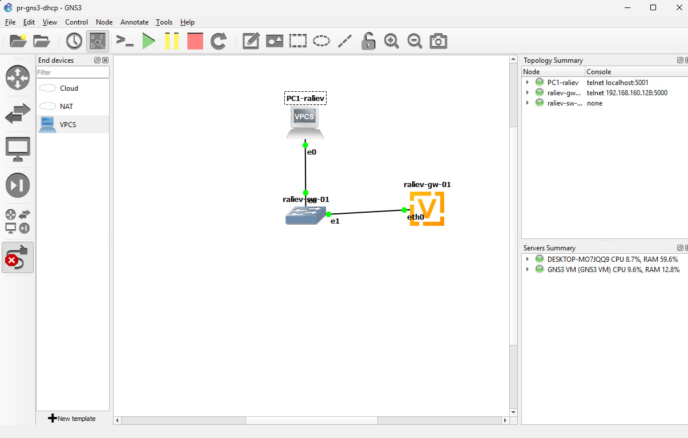
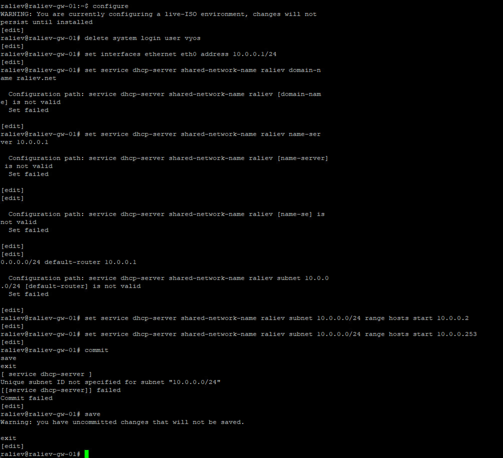
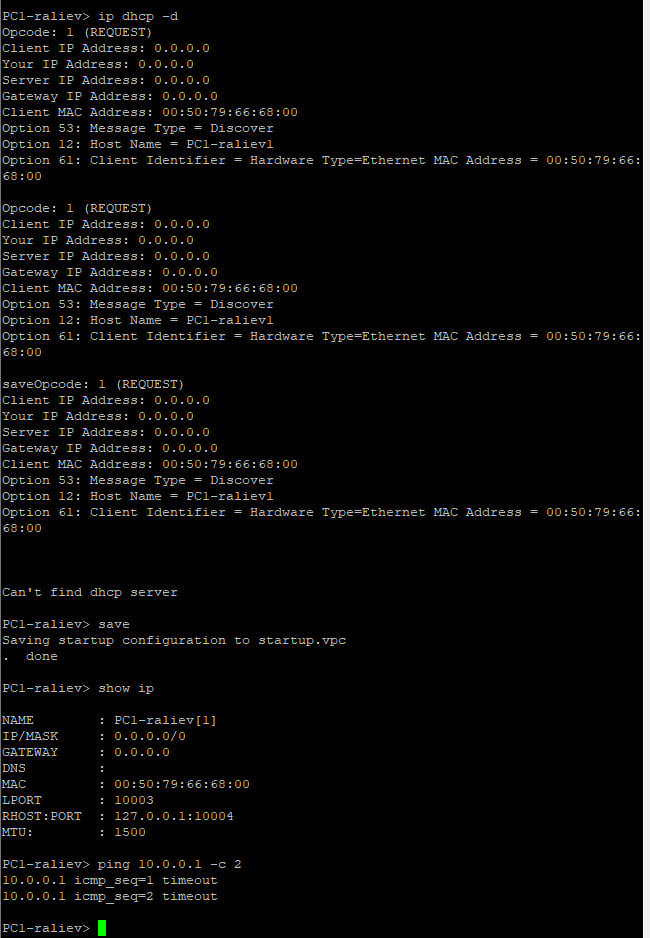
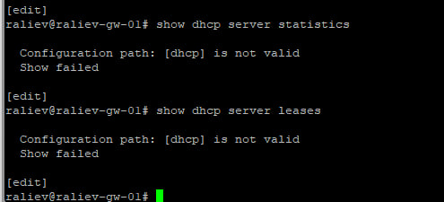
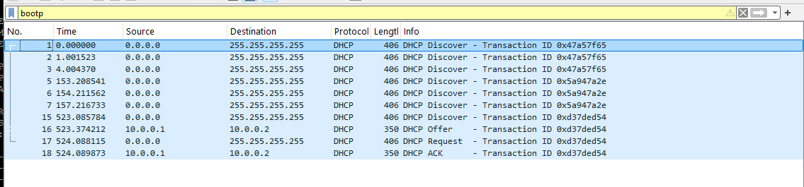
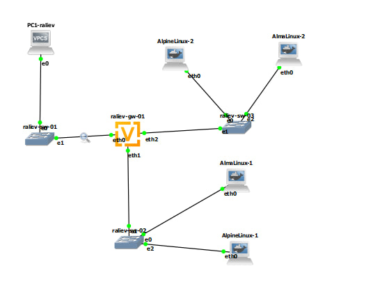
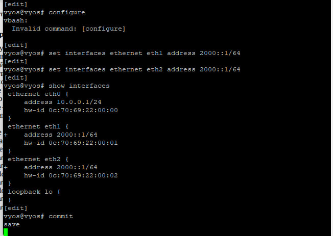
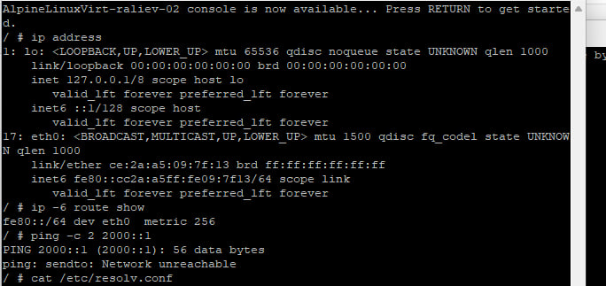
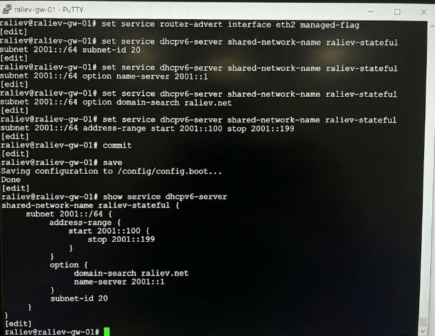
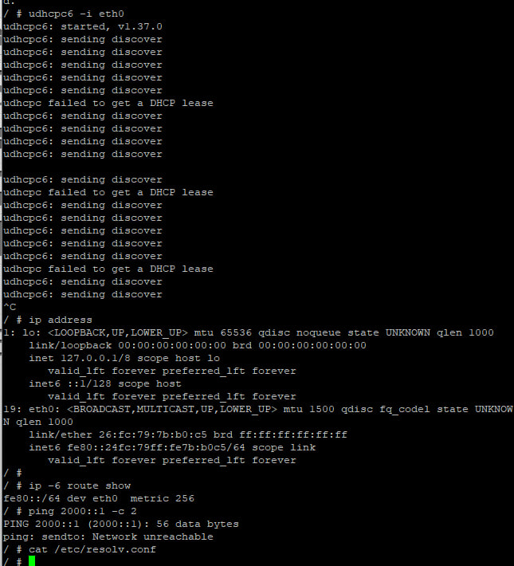

# Информация

## Докладчик

* **Докладчик:** Алиев Руслан Нияз оглы
* **Учебная группа:** НПИбд-01-24
* **Студенческий билет:** 1132247533
* **Учебное заведение:** Российский университет дружбы народов
* **Корпоративная почта:** 1132247533@pfur.ru

# Вводная часть

## Цель и теоретическая база

* **Цель работы:** получение практических навыков настройки службы DHCP на сетевом оборудовании (VyOS) для распределения адресов IPv4 и IPv6.
* **Протокол DHCP:** прикладной сетевой протокол модели «клиент-сервер» поверх UDP.
* **Задачи:** реализация пула IPv4 (DORA), бессерверной конфигурации Stateless DHCPv6 (SLAAC + O-flag) и централизованной Stateful DHCPv6 (M-flag).

# Часть 1. Настройка DHCP для IPv4

## 1. Топология сети IPv4

* В GNS3 собрана схема. Узлы: маршрутизатор raliev-gw-01, коммутатор raliev-sw-01, клиент PC1-raliev (VPCS).
* Запущен захват кадров Wireshark на транзитном линке sw-01 - gw-01.

{width=65%}

## 2. Конфигурирование DHCPv4 на VyOS

* Назначен статический IPv4-адрес 10.0.0.1/24 на eth0.
* Создана разделяемая сеть raliev и пул адресов 10.0.0.2 - 10.0.0.253.
* Сконфигурированы опции: шлюз по умолчанию 10.0.0.1 и DNS-сервер 10.0.0.1.

{width=65%}

## 3. Получение конфигурации узлом PC1

* На клиенте PC1-raliev выполнена команда ip dhcp -d с флагом отладки.
* Зафиксирован четырехэтапный цикл DORA и назначение адреса 10.0.0.2/24.
* Командой ping 10.0.0.1 -c 2 подтверждена прямая сетевая связность.

{width=65%}

## 4. Мониторинг аренды и системный журнал

* На маршрутизаторе выполнены команды show dhcp server statistics и show dhcp server leases.
* Зафиксирована привязка IP 10.0.0.2 к аппаратному MAC-адресу сетевого интерфейса PC1.
* Системный журнал show log | grep dhcp подтверждает регистрацию аренды демоном.

{width=65%}

## 5. Анализ трафика DHCPv4 в Wireshark

* В анализаторе применен фильтр bootp.
* 1. DHCP Discover (0.0.0.0 -> 255.255.255.255) - поиск доступных серверов клиентом.
* 2. DHCP Offer (10.0.0.1 -> 10.0.0.2) - предложение свободных параметров сервером.
* 3. DHCP Request - запрос клиента на фиксацию предложенных параметров.
* 4. DHCP ACK - подтверждение аренды сервером с передачей времени lease time.

{width=65%}

# Часть 2. Настройка DHCP для IPv6

## 6. Топология сети IPv6

* Топология расширена. Подключены коммутаторы raliev-sw-02, raliev-sw-03 и хосты AlmaLinux и AlpineLinux.
* Запущен захват кадров Wireshark на каналах маршрутизатора eth1 и eth2.

{width=65%}

## 7. Конфигурация Stateless DHCPv6 (eth1)

* Интерфейсу eth1 назначен адрес 2000::1/64.
* В службе Router Advertisement включен префикс 2000::/64 и other-config-flag.
* В пуле raliev-stateless объявлены опции DNS 2000::1 и домен raliev.net без пула адресов.

{width=65%}

## 8. Проверка клиента Stateless (PC2)

* На узле PC2 проверен адрес ip address и таблица маршрутов ip -6 route show.
* Адрес сформирован автономно по протоколу SLAAC на основе префикса из пакета RA.
* Файл resolv.conf содержит DNS 2000::1; пинг до шлюза ping 2000::1 -c 2 успешен.

{width=65%}

## 9. Конфигурация Stateful DHCPv6 (eth2)

* Интерфейсу eth2 назначен адрес 2001::1/64.
* В службе Router Advertisement включен флаг managed-flag.
* Сконфигурирован централизованный пул адресов 2001::100 - 2001::199 и параметры DNS.

{width=65%}

## 10. Проверка клиента Stateful (PC3)

* На узле PC3 (AlpineLinux) выполнен запрос аренды: udhcpc6 -i eth0.
* Клиент получил адрес 2001::100 из пула и DNS-сервер 2001::1.
* Утилитой ping 2001::1 -c 2 подтверждена двусторонняя связность со шлюзом.

{width=65%}

# Заключительная часть

## Выводы

* На оборудовании VyOS настроен сервис DHCPv4 и проанализированы опции протокола (DORA).
* Реализована схема Stateless DHCPv6 (SLAAC + O-flag): автоконфигурация адреса без хранения состояния на сервере.
* Настроен Stateful DHCPv6 (M-flag): централизованное выделение адресов из пула с отслеживанием по DUID.
