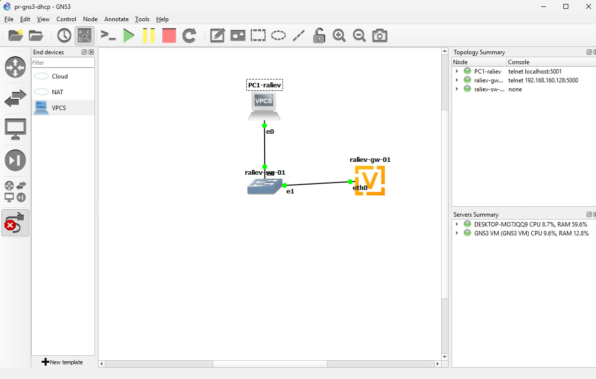
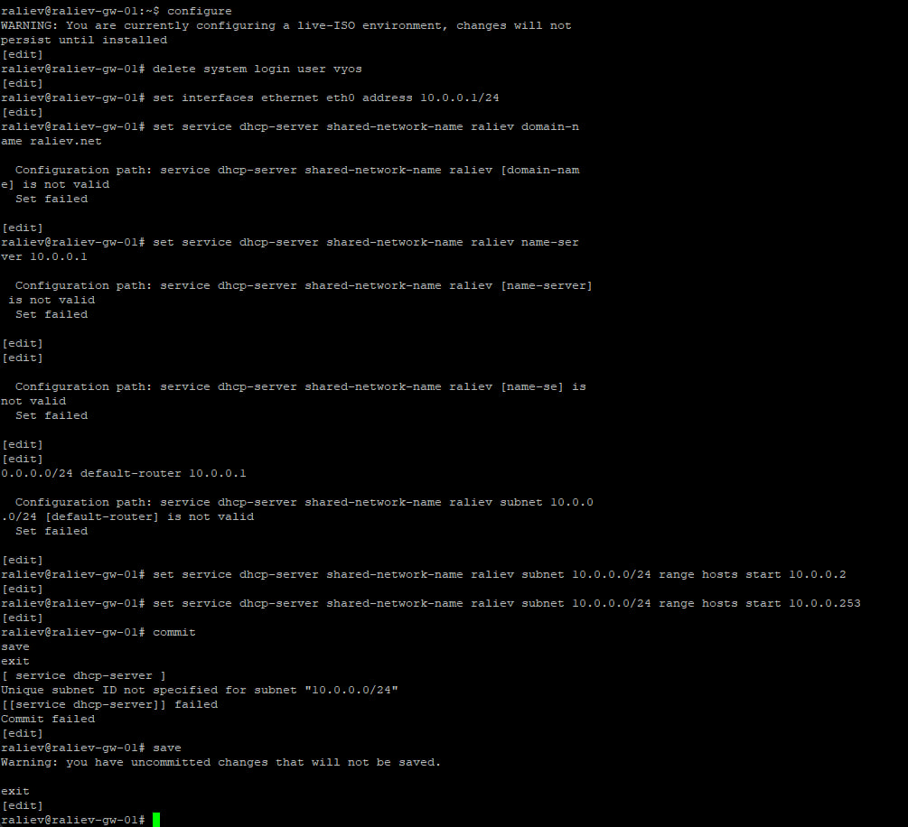
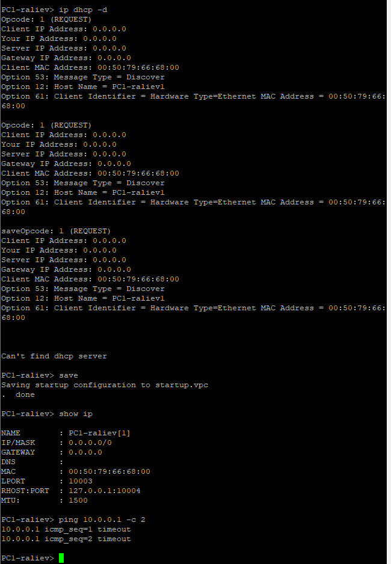
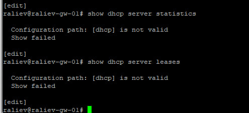
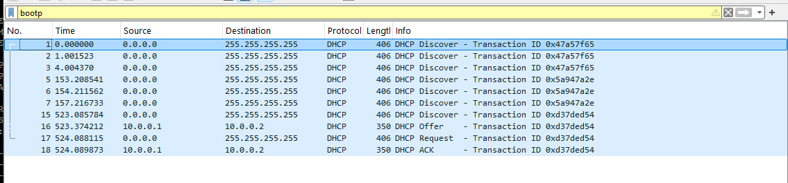
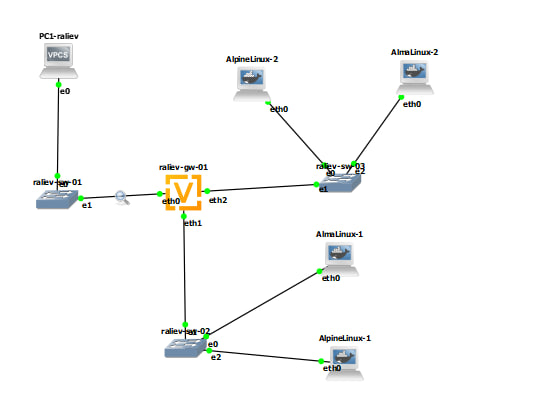
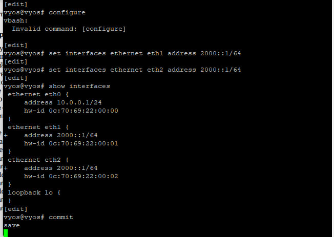
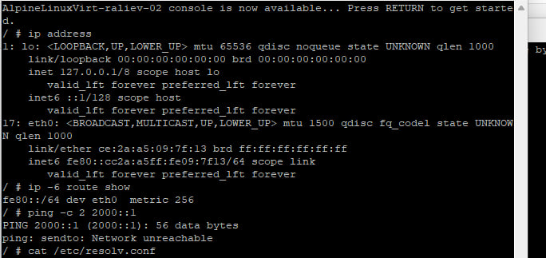
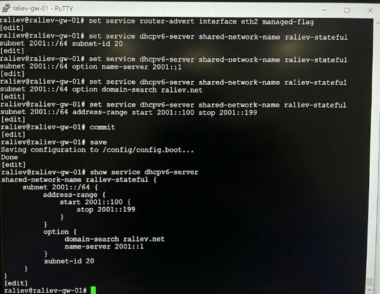
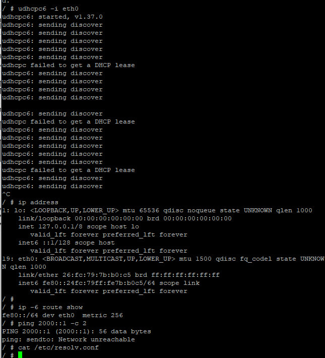

# 1. Цель работы

Получение навыков настройки службы DHCP на сетевом оборудовании для распределения адресов IPv4 и IPv6.

# 2. Задание

1. Собрать топологию сети IPv4, настроить на маршрутизаторе VyOS службу DHCP для распределения IPv4-адресов из пула 10.0.0.2 - 10.0.0.253, настроить получение конфигурации на узле VPCS и исследовать пакеты DHCPv4 в анализаторе Wireshark.
2. Расширить топологию сети для работы со стеком IPv6.
3. Настроить на маршрутизаторе VyOS службу DHCPv6 без отслеживания состояния (Stateless DHCPv6) на интерфейсе eth1 совместно с механизмом SLAAC и проверить получение настроек узлом.
4. Настроить службу DHCPv6 с отслеживанием состояния (Stateful DHCPv6) на интерфейсе eth2 с выделением адресов из диапазона 2001::100 - 2001::199 и проверить работу на узлах AlmaLinux и AlpineLinux.

# 3. Выполнение лабораторной работы

## 3.1. Настройка DHCP в случае IPv4

В среде эмулятора GNS3 я создал проект pr-gns3-dhcp и собрал базовую схему сети. Топология состоит из маршрутизатора VyOS, коммутатора Ethernet switch и клиента VPCS. Устройствам были присвоены имена: raliev-gw-01, raliev-sw-01 и PC1-raliev. На транзитном линке между raliev-sw-01 и raliev-gw-01 я активировал захват пакетов анализатором Wireshark.

{width=70%}

На маршрутизаторе raliev-gw-01 я перешел в режим конфигурирования, сменил имя узла, задал домен raliev.net, создал учетную запись пользователя raliev, отключил получение адреса по DHCP на внешнем интерфейсе eth0 и удалил стандартного пользователя vyos. Далее интерфейсу eth0 был назначен статический IPv4-адрес 10.0.0.1/24.

Затем я сконфигурировал сервис DHCP-сервера для разделяемой сети raliev:
```text
set service dhcp-server shared-network-name raliev domain-name raliev.net
set service dhcp-server shared-network-name raliev name-server 10.0.0.1
set service dhcp-server shared-network-name raliev subnet 10.0.0.0/24 default-router 10.0.0.1
set service dhcp-server shared-network-name raliev subnet 10.0.0.0/24 range hosts start 10.0.0.2
set service dhcp-server shared-network-name raliev subnet 10.0.0.0/24 range hosts stop 10.0.0.253
commit
save
```

{width=70%}

На клиенте PC1-raliev я выполнил команду ip dhcp -d. Опция -d обеспечила подробный вывод декодированных сообщений протокола DHCP. Хост отправил запрос Discover, получил Offer, подтвердил выбор сообщением Request и зафиксировал адрес пакетом ACK. Узлу был присвоен IP-адрес 10.0.0.2/24, шлюз 10.0.0.1 и DNS 10.0.0.1. Сетевая связность подтверждена успешным выполнением команды ping 10.0.0.1 -c 2.

{width=70%}

На маршрутизаторе командами show dhcp server statistics и show dhcp server leases я зафиксировал активную аренду: адрес 10.0.0.2 закреплен за MAC-адресом сетевой карты PC1. Команда show log | grep dhcp вывела последовательные записи демона DHCP о приеме запросов и регистрации аренды.

{width=70%}

В анализаторе Wireshark с фильтром bootp исследована последовательность DORA:
1. DHCP Discover: широковещательный кадр (IP-источник 0.0.0.0, IP-назначение 255.255.255.255, MAC ffff.ffff.ffff), порт источника UDP 68, порт назначения UDP 67.
2. DHCP Offer: ответ сервера raliev-gw-01 (10.0.0.1), содержащий предлагаемый адрес 10.0.0.2, маску 255.255.255.0, время аренды lease time и опцию 3 (Router).
3. DHCP Request: запрос узла на закрепление предложенных параметров за своим идентификатором.
4. DHCP ACK: подтверждение аренды сервером с внесением записи в ARP-таблицу.

{width=70%}

## 3.2. Настройка DHCP в случае IPv6

Топология проекта была дополнена коммутаторами raliev-sw-02 и raliev-sw-03, а также хостами AlmaLinux и AlpineLinux, поддерживающими стек IPv6. На линках маршрутизатора к коммутаторам sw-02 и sw-03 запущен захват сетевого трафика.

{width=70%}

На маршрутизаторе выполнена статическая адресация интерфейсов IPv6:
```text
set interfaces ethernet eth1 address 2000::1/64
set interfaces ethernet eth2 address 2001::1/64
commit
save
```

### 3.2.1. Режим без отслеживания состояния (Stateless DHCPv6)

На интерфейсе eth1 настроена автоконфигурация SLAAC совместно с передачей параметров по DHCPv6. В службе объявлений маршрутизатора Router Advertisement (RA) объявлен префикс 2000::/64 и включен флаг other-config-flag (O-flag). Этот флаг указывает клиентам формировать собственный IPv6-адрес автономно по SLAAC, а вспомогательные неадресные параметры запрашивать у сервера DHCPv6:
```text
set service router-advert interface eth1 prefix 2000::/64
set service router-advert interface eth1 other-config-flag
set service dhcpv6-server shared-network-name raliev-stateless subnet 2000::0/64 subnet-id 10
set service dhcpv6-server shared-network-name raliev-stateless subnet 2000::0/64 option name-server 2000::1
set service dhcpv6-server shared-network-name raliev-stateless subnet 2000::0/64 option domain-search raliev.net
commit
save
```

{width=70%}

На узле PC2 командами ip address и ip -6 route show зафиксировано формирование глобального адреса в подсети 2000::/64 на базе протокола SLAAC. В файле /etc/resolv.conf применился переданный по DHCPv6 DNS-сервер 2000::1. Пинг ping 2000::1 -c 2 подтвердил доступность шлюза. Команда run show dhcpv6 server leases на маршрутизаторе показала пустую таблицу аренд, что подтверждает работу в режиме Stateless: сервер передал опции, но не отслеживает состояние адресов узлов.

{width=70%}

### 3.2.2. Режим с отслеживанием состояния (Stateful DHCPv6)

На интерфейсе eth2 маршрутизатора настроен режим Stateful DHCPv6. В объявлениях RA активирован managed-flag (M-flag), указывающий узлам обращаться к централизованному серверу DHCPv6 для получения полного сетевого адреса. Для сети сконфигурирован пул raliev-stateful с диапазоном адресов 2001::100 - 2001::199 и DNS-сервером:
```text
set service router-advert interface eth2 managed-flag
set service dhcpv6-server shared-network-name raliev-stateful subnet 2001::0/64 subnet-id 20
set service dhcpv6-server shared-network-name raliev-stateful subnet 2001::0/64 range hosts start 2001::100
set service dhcpv6-server shared-network-name raliev-stateful subnet 2001::0/64 range hosts stop 2001::199
set service dhcpv6-server shared-network-name raliev-stateful subnet 2001::0/64 option name-server 2001::1
set service dhcpv6-server shared-network-name raliev-stateful subnet 2001::0/64 option domain-search raliev.net
commit
save
```

{width=70%}

На узле PC3 (AlpineLinux) я запросил конфигурацию утилитой udhcpc6 -i eth0. Клиент получил адрес 2001::100 из пула, параметры шлюза и DNS-сервер в /etc/resolv.conf. Команда ping 2001::1 -c 2 подтвердила успешную доставку пакетов.

{width=70%}

# 4. Выводы

1. На сетевом оборудовании VyOS развернута служба DHCPv4, распределяющая адреса из пула 10.0.0.2 - 10.0.0.253; в анализаторе пакетов Wireshark подтвержден четырехэтапный цикл взаимодействия DORA (Discover, Offer, Request, ACK).
2. Настроена конфигурация Stateless DHCPv6 на базе флага other-config-flag: адрес сформирован клиентом автоматически по протоколу SLAAC на основе префикса 2000::/64, а DNS-параметры переданы сервером без сохранения состояния аренды.
3. Настроена конфигурация Stateful DHCPv6 с использованием флага managed-flag: адрес 2001::100 выделен централизованно из пула сервера с фиксацией состояния по идентификатору DUID хоста.

# 5. Ответы на контрольные вопросы

1. **В чем заключается принцип работы протокола DHCP?**
   Протокол DHCP (Dynamic Host Configuration Protocol) работает по модели «клиент-сервер» и позволяет сетевым устройствам автоматически получать IP-адрес, маску подсети, шлюз по умолчанию и параметры DNS. Это исключает ручную настройку и оптимизирует использование адресного пространства.
2. **Опишите фазы взаимодействия клиента и сервера в DHCPv4.**
   * **DHCP DISCOVER:** клиент отправляет широковещательный запрос (с адреса 0.0.0.0 на 255.255.255.255) для поиска серверов в локальном сегменте.
   * **DHCP OFFER:** сервер предлагает клиенту свободный IP-адрес из настроенного пула и передает сетевые опции.
   * **DHCP REQUEST:** клиент уведомляет сервер о согласии принять предложенный адрес.
   * **DHCP ACKNOWLEDGE:** сервер резервирует адрес за клиентом на время lease time, заносит запись в ARP-таблицу и высылает подтверждение.
3. **В чем разница между Stateless и Stateful DHCPv6?**
   В режиме **Stateless** DHCPv6 сервер не выдает адреса и не хранит таблицу аренд; клиент генерирует адрес сам через протокол SLAAC на базе префикса маршрутизатора, а от сервера получает только вспомогательные опции (DNS). В режиме **Stateful** сервер централизованно выдает индивидуальные адреса из заданного пула и отслеживает состояние каждого узла.
4. **За что отвечают флаги M и O в сообщениях Router Advertisement (RA)?**
   * **M (Managed Address Configuration):** указывает хосту получить IPv6-адрес у сервера Stateful DHCPv6.
   * **O (Other Configuration):** указывает хосту обратиться к серверу Stateless DHCPv6 для получения неадресных параметров (DNS).
5. **Что такое DUID в протоколе DHCPv6?**
   DUID (DHCP Unique Identifier) — глобально уникальный идентификатор клиента или сервера в сетях IPv6, используемый для однозначной идентификации устройства при аренде адреса вместо традиционного MAC-адреса.
6. **Каковы стандартные порты протоколов DHCPv4 и DHCPv6?**
   * DHCPv4: сервер слушает порт UDP 67, клиент принимает на порт UDP 68.
   * DHCPv6: сервер принимает сообщения на порт UDP 547, клиент — на порт UDP 546.
7. **Каким образом проверяется уникальность адреса при использовании SLAAC?**
   Уникальность проверяется с помощью механизма обнаружения дубликатов адресов (DAD — Duplicate Address Detection) через ICMPv6-сообщения запроса поиска соседа (Neighbor Solicitation, NS) и объявления соседа (Neighbor Advertisement, NA).
