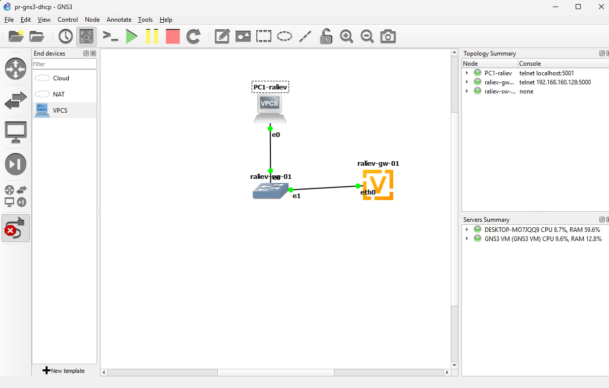
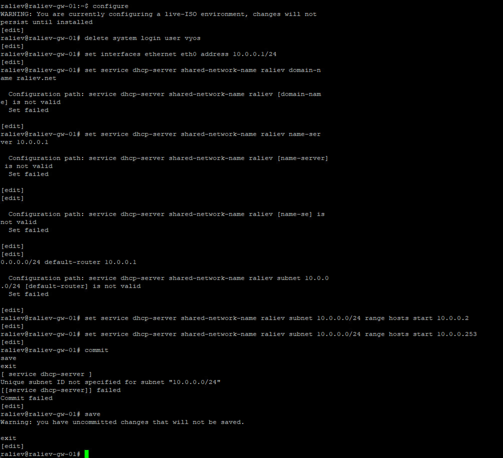
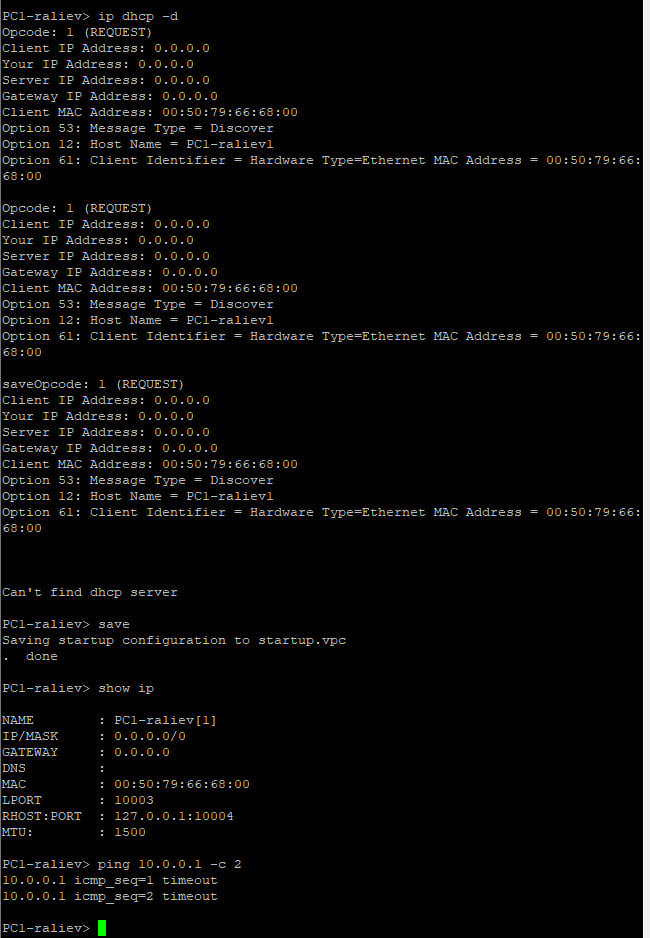
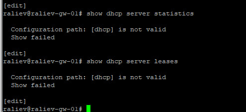
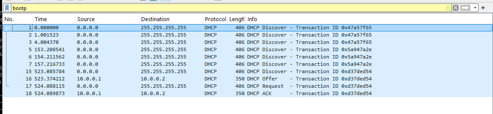
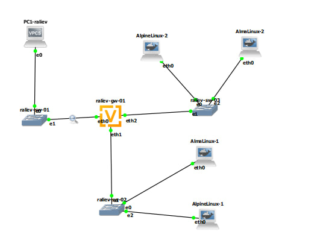
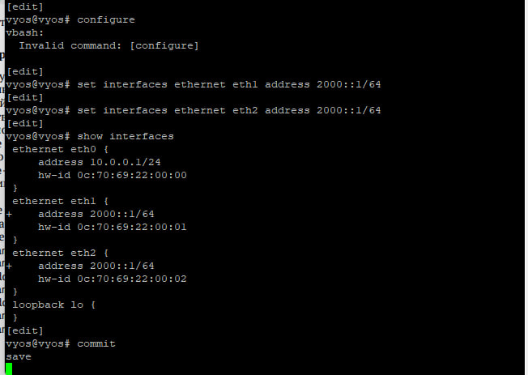

# 1. Цель работы

Приобретение практических навыков по установке и конфигурированию SMTP-сервера.

# 2. Задание

1. Установить на виртуальной машине `server` SMTP-сервер `postfix`.
2. Сделать первоначальную настройку `postfix` при помощи утилиты `postconf`, задав отправку писем не на локальный хост, а на сервер в домене.
3. Проверить отправку почты с сервера и клиента.
4. Сконфигурировать Postfix для работы в домене и проверить отправку почты с сервера и клиента.
5. Написать скрипт для Vagrant, фиксирующий действия по установке и настройке Postfix во внутреннем окружении виртуальных машин `server` и `client`, и внести изменения в `Vagrantfile`.

# 3. Выполнение лабораторной работы

## 3.1. Установка Postfix

1. На виртуальной машине `server` я перешёл в режим суперпользователя (`sudo -i`) и установил пакеты `postfix` и консольный почтовый клиент `s-nail`:
   `dnf -y install postfix s-nail`
2. Разрешил работу службы протокола SMTP в межсетевом экране командами `firewall-cmd --add-service=smtp` и `firewall-cmd --add-service=smtp --permanent`, восстановил контекст безопасности SELinux (`restorecon -vR /etc`), после чего включил и запустил службу `postfix` (рис. 1).



## 3.2. Изменение параметров Postfix с помощью postconf

1. С помощью утилиты `postconf` просмотрел текущие значения параметров `myorigin` и `mydomain`, заменил значение `myorigin` на `$mydomain` (`postconf -e 'myorigin = $mydomain'`), жёстко задал домен `postconf -e 'mydomain = raliev.net'` и оставил в списке протоколов только IPv4 (`postconf -e 'inet_protocols = ipv4'`).
2. Проверил корректность конфигурационного файла `/etc/postfix/main.cf` командой `postfix check`, перезагрузил конфигурацию `systemctl reload postfix` и вывел изменённые параметры командой `postconf -n` (рис. 2).



## 3.3. Проверка работы Postfix

1. На сервере отправил тестовое письмо пользователю `raliev` командой:
   `echo . | mail -s test1 raliev@server.raliev.net`
2. Проанализировал журнал `/var/log/maillog` и каталог `/var/spool/mail` (рис. 3).
   * **Пояснение по логу:** письмо **успешно доставлено**, о чём свидетельствуют строки `postfix/local[...]: to=<raliev@server.raliev.net>, relay=local, ... status=sent (delivered to mailbox)` и `postfix/qmgr[...]: removed` (сообщение доставлено в локальный почтовый ящик и удалено из активной очереди). В каталоге `/var/spool/mail/` появился файл почтового ящика пользователя `raliev`.



3. На виртуальной машине `client` установил пакеты `postfix` и `s-nail`, установил `postconf -e 'inet_protocols = ipv4'` и запустил службу `postfix`.
4. При первой попытке отправить письмо с `client` на `raliev@server.raliev.net` сообщение **не было доставлено** (осталось в очереди на клиенте со статусом `status=deferred (connect to server.raliev.net[192.168.1.1]:25: Connection refused)`), так как по умолчанию Postfix слушает только локальный петлевой интерфейс `inet_interfaces = localhost` (рис. 4).



5. Далее просмотрел параметры `inet_interfaces` и `mynetworks` и разрешил прослушивание всех сетевых интерфейсов и пересылку сообщений из локальной подсети (рис. 5):
   `postconf -e 'inet_interfaces = all'`
   `postconf -e 'mynetworks = 127.0.0.0/8, 192.168.0.0/16'`
   Затем выполнил проверку `postfix check` и перезапустил службу `postfix`.



## 3.4. Конфигурация Postfix для домена

1. С виртуальной машины `client` отправил письмо на доменный адрес `echo . | mail -s test2 raliev@raliev.net`.
2. Проверил журнал `/var/log/maillog` и очередь сообщений `postqueue -p` (рис. 6). До добавления MX-записи и настройки параметра `mydestination` сообщение задерживается в очереди на отправление.



3. Просмотрел состояние очереди `postqueue -p` (рис. 7). Для настройки доставки писем на доменный адрес `raliev@raliev.net` в файл прямой DNS-зоны `/var/named/master/fz/raliev.net` и обратной зоны `/var/named/master/rz/192.168.1` прописывается запись почтового обменника `MX 10 mail.raliev.net.` и адресные записи для узла `mail` (`192.168.1.1`):

```dns
$TTL 1D
@   IN SOA @ server.raliev.net. (
        2026102201 ; serial
        1D         ; refresh
        1H         ; retry
        1W         ; expire
        3H )       ; minimum
    NS      @
    A       192.168.1.1
    MX 10   mail.raliev.net.
$ORIGIN raliev.net.
server  A   192.168.1.1
ns      A   192.168.1.1
dhcp    A   192.168.1.1
www     A   192.168.1.1
mail    A   192.168.1.1
```

4. В конфигурации Postfix на сервере домен `$mydomain` добавляется в список конечных точек доставки:
   `postconf -e 'mydestination = $myhostname, localhost.$mydomain, localhost, $mydomain'`
   После перезагрузки `postfix`, восстановления контекста SELinux (`restorecon -vR /etc /var/named`), перезапуска `named` и отправки очереди командой `postqueue -f` почта доставляется на доменный адрес.



## 3.5. Внесение изменений в настройки внутреннего окружения виртуальной машины

1. Обновлённые файлы зон DNS копируются в каталог `/vagrant/provision/server/dns/var/named/`.
2. В каталоге `/vagrant/provision/server` создаётся исполняемый скрипт `mail.sh` для сервера:

```bash
#!/bin/bash
echo "Provisioning script $0"
echo "Install needed packages"
dnf -y install postfix
dnf -y install s-nail
echo "Copy configuration files"
#cp -R /vagrant/provision/server/mail/etc/* /etc
echo "Configure firewall"
firewall-cmd --add-service=smtp --permanent
firewall-cmd --reload
restorecon -vR /etc
echo "Start postfix service"
systemctl enable postfix
systemctl start postfix
echo "Configure postfix"
postconf -e 'mydomain = raliev.net'
postconf -e 'myorigin = $mydomain'
postconf -e 'inet_protocols = ipv4'
postconf -e 'inet_interfaces = all'
postconf -e 'mydestination = $myhostname, localhost.$mydomain, localhost,$mydomain'
postconf -e 'mynetworks = 127.0.0.0/8, 192.168.0.0/16'
postfix set-permissions
restorecon -vR /etc
systemctl stop postfix
systemctl start postfix
```

3. В каталоге `/vagrant/provision/client` создаётся исполняемый скрипт `mail.sh` для клиента, а в `Vagrantfile` добавляются блоки запуска `provision/server/mail.sh` и `provision/client/mail.sh`.

# 4. Выводы

В ходе выполнения лабораторной работы я приобрёл практические навыки по установке и конфигурированию SMTP-сервера Postfix и клиента `s-nail`, научился изменять параметры конфигурации через `postconf`, проанализировал работу почтовой очереди `postqueue` и журнала `/var/log/maillog`, настроил параметры приёма почты по сети и для домена `raliev.net` с использованием MX-записей в DNS, а также подготовил скрипты провижининга для Vagrant.

# 5. Ответы на контрольные вопросы

1. **В каком каталоге и в каком файле следует смотреть конфигурацию Postfix?**
   Конфигурационные файлы почтового сервера Postfix хранятся в каталоге **`/etc/postfix/`**, а основным файлом конфигурации является **`/etc/postfix/main.cf`** (настройки запуска демонов хранятся в `/etc/postfix/master.cf`).
2. **Каким образом можно проверить корректность синтаксиса в конфигурационном файле Postfix?**
   Для проверки корректности синтаксиса конфигурационного файла `main.cf` и прав доступа используется команда:
   `postfix check`
   Если ошибок нет, команда завершается без вывода диагностических сообщений. Также просмотреть все изменённые относительно стандартных значения позволяет команда `postconf -n`.
3. **В каких параметрах конфигурации Postfix требуется внести изменения в значениях для настройки возможности отправки писем не на локальный хост, а на доменные адреса?**
   Необходимо изменить следующие параметры в `/etc/postfix/main.cf` (или через `postconf -e`):
   * `mydomain = raliev.net` — задать имя почтового домена;
   * `myorigin = $mydomain` — указать домен, подставляемый в адрес отправителя для исходящей почты;
   * `inet_interfaces = all` — разрешить серверу принимать почтовые соединения на всех сетевых интерфейсах, а не только на `localhost`;
   * `mynetworks = 127.0.0.0/8, 192.168.0.0/16` — указать доверенные IP-подсети для пересылки почты;
   * `mydestination = $myhostname, localhost.$mydomain, localhost, $mydomain` — включить сам домен `$mydomain` в список конечных точек доставки почты (а в DNS-зоне домена прописать соответствующую запись `MX`).
4. **Приведите примеры работы с утилитой mail по отправке письма, просмотру имеющихся писем, удалению письма.**
   * **Отправка письма из командной строки:**
     `echo "Текст письма" | mail -s "Тема письма" raliev@raliev.net`
   * **Просмотр имеющихся писем:**
     Запустить интерактивный режим командой `mail`. На экран выведется список заголовков писем с номерами. Для чтения конкретного письма нужно ввести его номер (например, `1`) или `n` для перехода к следующему письму; `h` — вновь вывести список заголовков.
   * **Удаление письма:**
     В интерактивном режиме `mail` ввести `d 1` (удалить письмо под номером 1) или `dq` (удалить текущее письмо и сразу выйти с сохранением изменений), либо `q` для выхода.
5. **Приведите примеры работы с утилитой postqueue. Как посмотреть очередь сообщений? Как определить число сообщений в очереди? Как отправить все сообщения, находящиеся в очереди? Как удалить письмо из очереди?**
   * **Посмотреть очередь сообщений и определить их число:**
     `postqueue -p` (или `mailq`) — выводит список всех писем в очереди (их `Queue ID`, размер, время, отправителя и получателя), а в последней итоговой строке указывает общее число сообщений в очереди (например: `-- 0 Kbytes in 2 Requests.`).
   * **Отправить все сообщения, находящиеся в очереди (немедленно повторить доставку):**
     `postqueue -f` (или `postfix flush`).
   * **Удалить письмо из очереди:**
     Для удаления писем из очереди используется административная утилита **`postsuper`**:
     * удалить конкретное письмо по его идентификатору: `postsuper -d <Queue_ID>`;
     * удалить абсолютно все письма из очереди: `postsuper -d ALL` (или только отложенные: `postsuper -d ALL deferred`).
